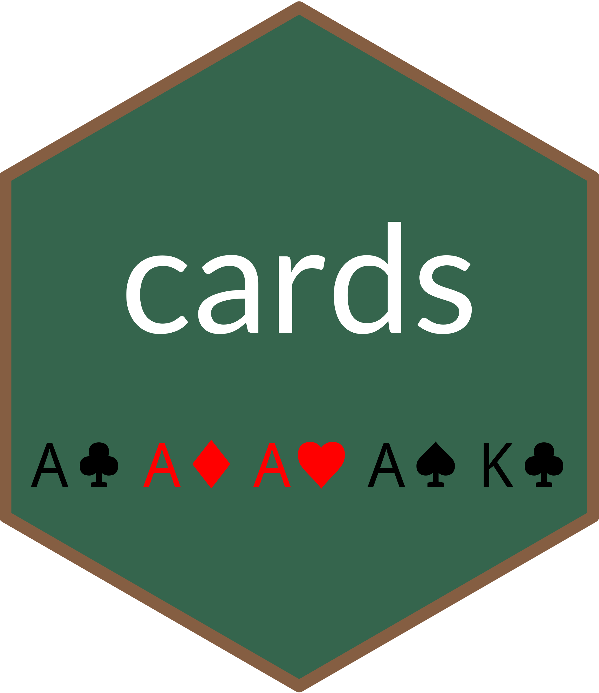

<!-- README.md is generated from README.Rmd. Please edit that file -->

# cards 

<!-- badges: start -->

[](https://github.com/jabenninghoff/cards/actions)
[](https://github.com/jabenninghoff/cards/actions)
[](https://app.codecov.io/gh/jabenninghoff/cards)
<!-- badges: end -->

## Overview

**Card Simulation Tools:** Tools for card game simulations, written in
base R.

Feel free to use and/or fork this project!

## Installation

You can install the development version of cards from
[GitHub](https://github.com/) with:

``` r
# install.packages("remotes")
remotes::install_github("jabenninghoff/cards")
```

Or using renv:

``` r
# install.packages("renv")
renv::install("jabenninghoff/cards")
```

## Development

- Changelog: See “Changelog” or `NEWS.md`.
- Planned: [TODO](TODO.md)

## Usage

The cards package supports random draws and evaluation of poker rank
[category](https://en.wikipedia.org/wiki/List_of_poker_hands):

``` r
library(cards)

deck <- new_deck()
replicate(50, {
  hand <- deal_hand(deck)
  paste0(print_hand(hand), ": ", eval_hand(hand))
})
#>  [1] "8D AS 8H AC 9D: two_pair"     "8S 3S 5C 2H QD: high_card"   
#>  [3] "3D QD 9C 9H 3C: two_pair"     "9D 9S KD QH KC: two_pair"    
#>  [5] "KC 3H 8C KD 4S: jacks_better" "3C 2D 4S TD AC: high_card"   
#>  [7] "KC 6H QD 2D 8D: high_card"    "AH 8D JS AS 2S: jacks_better"
#>  [9] "KC 7H TD KD 4C: jacks_better" "5S 6H TS 4D 2D: high_card"   
#> [11] "2C JH 9H 3H QC: high_card"    "9C 6C 7C KH 6H: one_pair"    
#> [13] "6H TH 4H 6D AD: one_pair"     "6H 5D 8C 6C 2D: one_pair"    
#> [15] "KH QS 9C AH 5H: high_card"    "9C 3H AS 4D JC: high_card"   
#> [17] "9C 3H JS 2S 8S: high_card"    "3H 8D 4D KC AC: high_card"   
#> [19] "2D AH 7D 9S 8H: high_card"    "7C KC 9H KS 4H: jacks_better"
#> [21] "6S AS JD JC 3H: jacks_better" "6C 4H 6H 5S QS: one_pair"    
#> [23] "9H QS AS 4D 8H: high_card"    "JD 4D 9H 8C 7S: high_card"   
#> [25] "8D JC 5D KC 9D: high_card"    "TH 7S 5D 5S 8D: one_pair"    
#> [27] "7H 3D AC 4C TH: high_card"    "3H 5H 2H QC JH: high_card"   
#> [29] "6H 4D 8D 3H QC: high_card"    "7D 2C 8S AS AH: jacks_better"
#> [31] "JC 3C 9H TS 6S: high_card"    "TS 7S 3S 5H 2S: high_card"   
#> [33] "QC 2D AH 4S 7D: high_card"    "KD 4H 7S 6C JD: high_card"   
#> [35] "4S KS 9D 8H 5H: high_card"    "7S 7H 8S TD 9C: one_pair"    
#> [37] "8H KC AC JH 2H: high_card"    "8H 3D 9C JD TD: high_card"   
#> [39] "QC 2H 5H AH 6S: high_card"    "KS 2S 6H TD 8C: high_card"   
#> [41] "7D JH 8S AD KC: high_card"    "2D AH 6S 8C 8D: one_pair"    
#> [43] "6H AS KC 9C 5H: high_card"    "JS 5C 2S TD 4C: high_card"   
#> [45] "4D 9D TC 8S JS: high_card"    "4S 5D JH KS 2H: high_card"   
#> [47] "5D 9C 4S QD 7H: high_card"    "5D 5H KS 4D 3S: one_pair"    
#> [49] "JH KS 5C 7C AC: high_card"    "4S QS AD 9D 7S: high_card"
```
