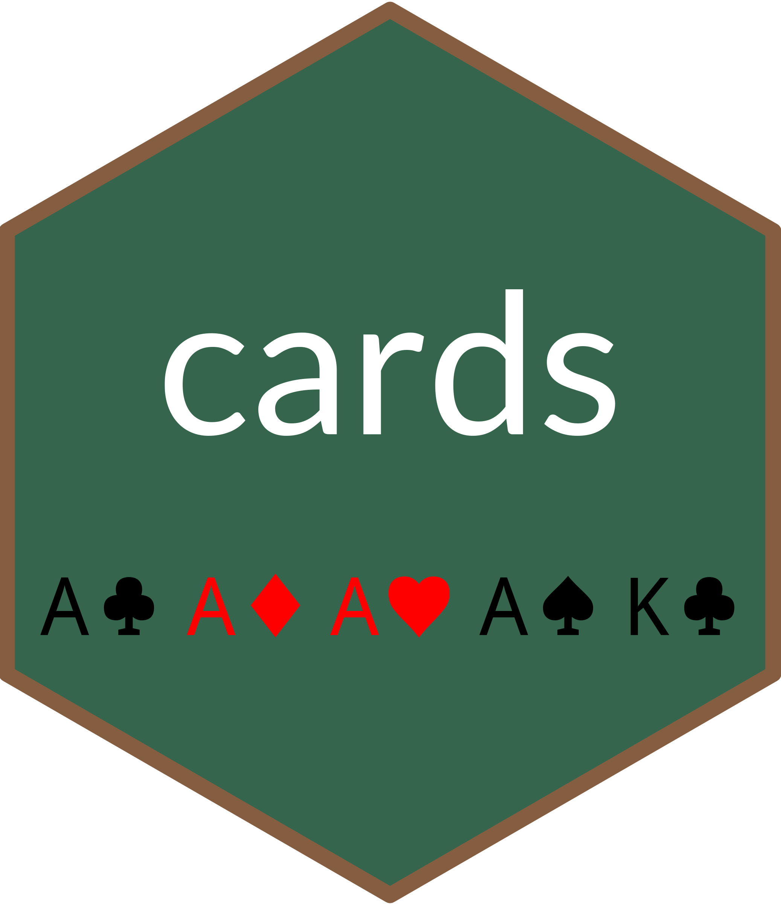

<!-- README.md is generated from README.Rmd. Please edit that file -->

# cards 

<!-- badges: start -->

[](https://github.com/jabenninghoff/cards/actions)
[](https://github.com/jabenninghoff/cards/actions)
[](https://app.codecov.io/gh/jabenninghoff/cards)
<!-- badges: end -->

## Overview

**Card Simulation Tools:** Tools for card game simulations, written in
base R.

Feel free to use and/or fork this project!

## Installation

You can install the development version of cards from
[GitHub](https://github.com/) with:

``` r
# install.packages("remotes")
remotes::install_github("jabenninghoff/cards")
```

Or using renv:

``` r
# install.packages("renv")
renv::install("jabenninghoff/cards")
```

## Development

- Changelog: See “Changelog” or `NEWS.md`.
- Planned: [TODO](TODO.md)

## Usage

The cards package supports random draws and evaluation of poker rank
[category](https://en.wikipedia.org/wiki/List_of_poker_hands):

``` r
library(cards)

deck <- new_deck()
replicate(50, {
  hand <- deal_hand(deck)
  paste0(print_hand(hand), ": ", eval_hand(hand))
})
#>  [1] "AC 3S 7D 9H 8C: high_card"     "JD 3C AS 9H QD: high_card"    
#>  [3] "KH KC TS 7S QS: jacks_better"  "JC QC AC KC 7H: high_card"    
#>  [5] "JD AS KD 9C TS: high_card"     "JH JD 6S TS 2C: jacks_better" 
#>  [7] "8C 9C 4S 7S KC: high_card"     "6H 2H KC KS 9D: jacks_better" 
#>  [9] "8D 6D 3S 2C 4D: high_card"     "QH 8D JS 9C TD: straight"     
#> [11] "AH 7S TC 7D 3C: one_pair"      "4S 5H 2H JS JC: jacks_better" 
#> [13] "5H 6S 8C 8D 8S: three_ofakind" "5D AH 9C 9H QS: one_pair"     
#> [15] "TS 8C 4S 2D 3D: high_card"     "7C KH 8H 7D 4D: one_pair"     
#> [17] "AD 2S 2C 2D AH: full_house"    "6H 7D 7C 9H 9D: two_pair"     
#> [19] "2S 9S 2D 3D TH: one_pair"      "5D 3H KS 3S 9H: one_pair"     
#> [21] "7S AD 2C 9S QH: high_card"     "9S 2S KS 8D AH: high_card"    
#> [23] "9H 8D KS QC 5D: high_card"     "5S 5H AC 3S KH: one_pair"     
#> [25] "QC 4H 6C 9H 6S: one_pair"      "TS 7S 9C TH 9D: two_pair"     
#> [27] "TD 5H AC 8C 6D: high_card"     "TD 7H TC 4S 7S: two_pair"     
#> [29] "5D 4C 2C 6S AS: high_card"     "AC 7D 9S 5H KC: high_card"    
#> [31] "6D 2S 7S 5H KH: high_card"     "QD AD 7S 7H AH: two_pair"     
#> [33] "4C JD QD 3D 6C: high_card"     "KD KC JS 7S 6H: jacks_better" 
#> [35] "9C 6S JC 7D 3D: high_card"     "7D QC QH QS 3S: three_ofakind"
#> [37] "TD JC 8D 9C QH: straight"      "TS 5D KC 9D QH: high_card"    
#> [39] "5D 7S KC AH 6H: high_card"     "9S 4H AS 9D TD: one_pair"     
#> [41] "2D 5D 3D 8S TC: high_card"     "2H AH AD 8S 3C: jacks_better" 
#> [43] "QD 8S 9S 3S TD: high_card"     "KS 6D 8C 5S 3D: high_card"    
#> [45] "8H JC QH KH 9C: high_card"     "8S 2C TH 6S 5H: high_card"    
#> [47] "3H 8D AD 4D 4S: one_pair"      "TD 9S 3S 9C 8H: one_pair"     
#> [49] "9H 5C 3H 6D 3C: one_pair"      "5D 3S TC JC 3H: one_pair"
```
